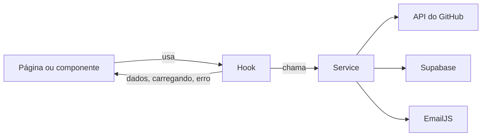

# Arquitetura

## Pastas

```
src/
  main.jsx        entrada: monta os providers e o router
  routes.jsx      todas as rotas, com lazy onde indicado
  config/site.js  dados pessoais e textos fixos
  components/
    ui/           Button, Card, Tag, Skeleton, Spinner, ErrorState, EmptyState
    layout/       Header, Footer, Layout
    home/         seções da página inicial
    projects/     ProjectCard, ProjectRow e skeletons
    contact/      ContactForm
    admin/        MessageList, FeaturedSelector
  pages/          uma por rota
  hooks/          estado e ciclo de vida
  services/       conversa com GitHub, Supabase e EmailJS
  context/        ThemeContext, AuthContext
  utils/          funções puras e testáveis
  test/           setup dos testes
.claude/          harness de IA (ver docs/harness.md)
.husky/           verificações antes do commit
docs/             requisitos, design e documentos do vídeo
supabase/         SQL das tabelas e permissões (chega na Fase 2)
```

## Fluxo de dados



O componente só desenha o que recebe. Exemplo planejado: `ProjectCard` recebe um repositório; `useRepos` cuida de cache e estados; `github.js` faz o `fetch`.

## Critério para dividir componentes

- Divide quando passa de ~120 linhas ou mistura dois assuntos.
- Vai para `ui/` o que aparece em mais de uma página.
- Fica na pasta da funcionalidade o que só faz sentido nela.
- Lógica sai para um hook; função pura, para `utils/`.

O ESLint recusa `fetch` e import de `services/` em `components/` e `pages/`.

## Caminho de uma alteração


